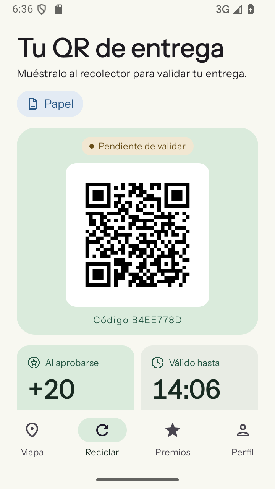
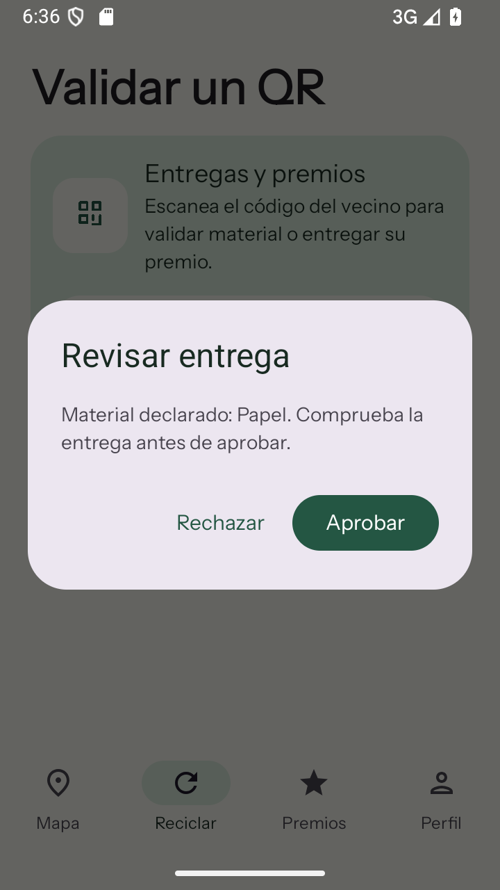
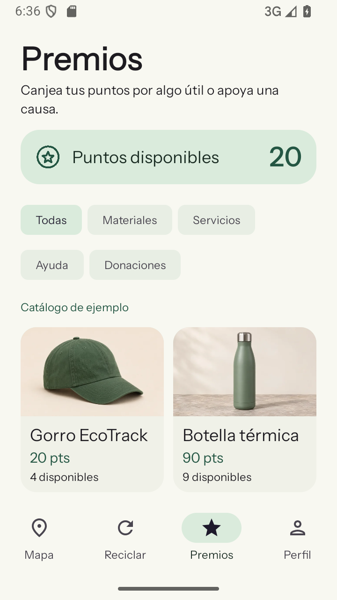
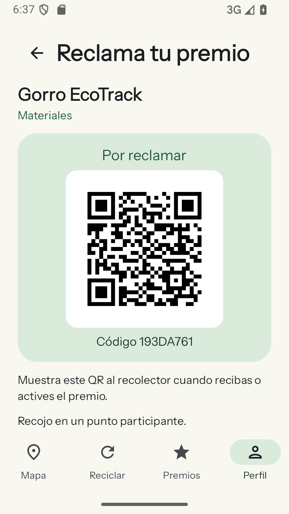
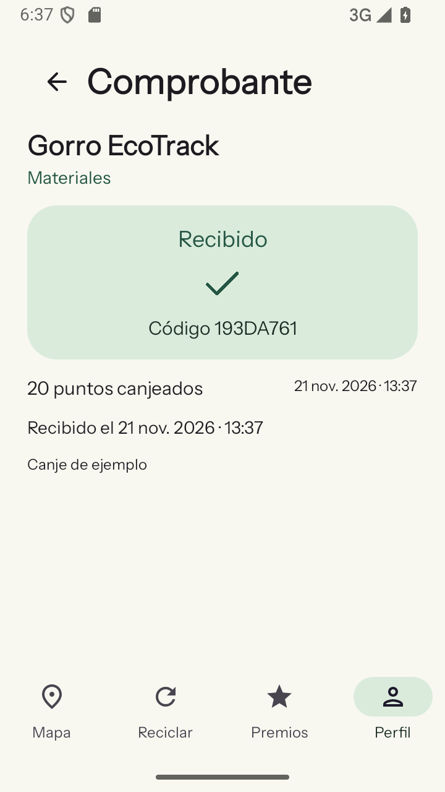

# EcoTrack para Android

EcoTrack es un piloto de reciclaje para Cajamarca. En un mismo teléfono puedes probar los roles de vecino y recolector, validar una entrega y canjear los puntos por un premio de ejemplo.

## Ejecutar el piloto

Abre el proyecto en Android Studio con JDK 21 o compila el APK desde la raíz en Windows.

```powershell
.\gradlew.bat :app:assembleDebug "-PecotrackSupabaseUrl=" "-PecotrackSupabasePublishableKey="
```

Instala el APK generado en `app/build/outputs/apk/debug/app-debug.apk`. El modo piloto de depuración se activa con la configuración anterior y guarda el saldo, las entregas y los comprobantes en el teléfono. El catálogo y los canjes son simulados. El flujo de entrega y canje funciona sin cuenta, Supabase ni servidor. El mapa en línea y las rutas a pie requieren conexión.

## Recorrido de prueba

1. En **Reciclar**, elige **Papel** y pulsa **Generar QR de entrega**.
2. En **Perfil**, pulsa **Probar como recolector**. Selecciona **Usar entrega de prueba** y **Aprobar**.
3. Abre **Premios** y verifica que se acreditaron **20 puntos**. Abre **Gorro EcoTrack** y pulsa **Canjear por 20 puntos**. La app genera el QR del premio.
4. Vuelve a **Reciclar** como recolector. Pulsa **Usar premio de prueba** y **Confirmar entrega**.
5. En **Perfil**, vuelve al rol de vecino y abre **Mis premios → Gorro EcoTrack**. El comprobante debe mostrar **Recibido** y **20 puntos canjeados**.

Los botones de prueba permiten usar en el mismo dispositivo los QR generados durante el recorrido. El QR de entrega vence en 30 minutos. El gorro tiene un límite de un canje por perfil de prueba.

## Capturas del piloto

| Entrega pendiente | Revisión del recolector | Saldo acreditado |
| --- | --- | --- |
|  |  |  |

| QR del premio | Comprobante |
| --- | --- |
|  |  |

## Recursos

- El clasificador de materiales funciona en el dispositivo con MobileNetV2 de WasteNet bajo licencia MIT. El [modelo que usa la app](https://github.com/KrisnaSantosa15/wastenet-garbage-classifier/tree/8d793623ee43af5d4fd98b057163921e7060b693) está incluido en el repositorio.
- Las imágenes del catálogo se generaron con ImageGen.
